# Initial 26.3 Vulkan integration evidence

Host: Windows 11, JDK 25, Minecraft 26.3, Fabric Loader 0.19.5, NVIDIA RTX 5060
Laptop GPU (8 GiB), driver 616.92. All runtime checks use isolated development
worlds. No PCL instance, player world or installed mod was modified.

## CPU and packaging

- `check compileSmokeTestJava`: 123 JUnit tests, zero failures/errors.
- Shader ABI, SPIR-V validation and production JAR metadata checks passed.
- Slang 2026.18; NGX shim built from source against DLSS SDK v310.7.0.
- Local JAR includes NVIDIA ray reconstruction/frame-generation runtimes.
  FSR, NRD and XeSS were not built or validated here.
- The development-only smoke mod is excluded from the production JAR.

## GPU runs

| Scene | Result | RT frames | Peak Voxy meshes | Peak RT LOD sections |
| --- | --- | ---: | ---: | ---: |
| gysf alone, SVGF, OMM disabled | Passed | 3330 | 0 | 0 |
| gysf + vooxxy, SVGF, OMM disabled | Passed | 3271 | 336 | 359 |
| gysf + vooxxy, default DLSS-RR + OMM | Passed, SDK validation caveat below | 3674 | 336 | 357 |
| gysf + vooxxy, default plus Nether round trip | Passed, same SDK caveat | 4561 | 336 | 359 |
| Final paired build, DLSS-RR, OMM disabled, Nether round trip | Passed, validation clean | 4634 | 336 | 355 |

These runs enter a fixed-seed world, move/teleport the camera, reload resource
packs, save, disconnect and stop. The joint runs load no Sodium. Vulkan and
synchronization validation report no VUID or synchronization hazards in the
SVGF/OMM-disabled baseline and joint runs. Default runtime created the DLSS-RR
feature and rendered after resource reload without device loss.
The extended default run additionally visits the Nether and returns to the
Overworld, recreating provider/RT world resources. Development settings are
854x480, 1 sample per pixel, 2 bounces and a 512-block external LOD cap; these
counts establish activity, not a performance benchmark.
The final run uses vooxxy commit `5c23b2219c3da076dd97b77cd999489f5f761edd`
and gysf code commit `d2afadc`. DLSS-RR stays active and only OMM is disabled to
avoid the SDK checker defect. It completes 4634 RT frames, resource reload and
the dimension round trip with no VUID, synchronization hazard, device loss or
provider/compositor failure. Both projects' final `check` tasks also pass.

vooxxy standalone Sodium/Vulkan lifecycle regression also passed block
placement/removal and light ingestion, 38,303 block-state persistence round trips,
renderer toggle/rebuild, FOV/window/distance changes, resource reload, Nether
round trip, save and exit. Its GPU wrapper counters return to zero. That run
reports no Vulkan VUID or synchronization hazards; Minecraft recovered from
a swapchain-out-of-date warning during window resize.

The first exploratory joint run lost the device when the provider advanced
Minecraft uploads from inside an RT frame. Provider advancement now occurs at
the start of the client tick, before RT frame command recording. The completed
runs above use this ordering and a shared device host lock.

## SDK validation caveat

Installed Vulkan SDK 1.4.341.1 reports `pInfos-10904` for a zero micromap index
address with `VK_INDEX_TYPE_NONE_KHR`. The code supplies the zero address
required by the specification. The SDK-tagged validation source mistakenly
reports zero (`if (!address)`); current Khronos source checks nonzero instead.
No workaround that violates Vulkan's contract was added to the renderer.

- [SDK-tagged checker](https://github.com/KhronosGroup/Vulkan-ValidationLayers/blob/vulkan-sdk-1.4.341/layers/core_checks/cc_ray_tracing.cpp)
- [Current checker](https://github.com/KhronosGroup/Vulkan-ValidationLayers/blob/main/layers/core_checks/cc_ray_tracing.cpp)

This is not described as a validation-clean default run. Revalidation with a
fixed checker remains useful. Unrelated Windows OSHI performance-counter
registry warnings also occur during Minecraft startup.

## Initial colour-proxy acceptance limits

Runtime data flow is demonstrated, not final visual acceptance. The current
colour proxy loses per-texel alpha/PBR and sub-block/fluid shape details. Sparse
visited terrain can leave incomplete far coverage. A screenshot cannot prove
seam-free lighting, temporal stability, correct reflections or production
performance. These limits describe the initial 0.1.0 prototype above.

## Textured consumer: gysf 0.2.0 and vooxxy Vulkan 5

Both projects pass `check`: 132 gysf tests and 22 provider API tests, with zero
failures/errors. The nine added CPU tests independently check face orientation,
sub-block depth boundaries, greedy UV repetition, fluid top/side heights,
rebasing, metadata identity, bucket layout and immutable snapshot ownership.
Shader compilation, SPIR-V validation, reflected ABI and production JAR checks
also pass. The provider commit is `2b77524e3b080108be7a875e9ea442abf14edfc0`.

| Textured scene | RT frames | Peak source meshes | Peak RT sections | Packed textured batches | Final atlas slot |
| --- | ---: | ---: | ---: | ---: | ---: |
| Fixed-seed world and dimension round trip | 4420 | 336 | 355 | 1520 | 7 |
| Added isolated material fixture and dimension round trip | 4166 | 421 | 446 | 1639 | 8 |
| External foliage cutout policy, visual control and full lifecycle | 4590 | 421 | 437 | 1601 | 7 |
| Final base-alpha coverage, short visual control | 2474 | 421 | 452 | 856 | 3 |

Both runs enable DLSS-RR and disable OMM to avoid the installed SDK checker bug.
They complete movement, resource reload, Nether travel and return, saving and
shutdown with zero VUID, synchronization hazard, device loss or external-provider
failure. The typed path is required by the harness: it rejects zero textured
batch count, an empty typed snapshot or an unbound atlas after returning.
The last full run also verifies nonzero leaf-cutout metadata (83,543 converted
leaf quads across its batches). The fixture's near RT section reports not ready,
and hiding only textured LOD hits removes the fixture at the same camera. That
control establishes that the samples are rendered through the LOD path.

Visual inspection additionally identified alpha mip averaging closing foliage
holes. Any-hit now reads base-level coverage, independently of the closest-hit
ray-cone mip choice for albedo. The final alpha visual run is recorded below.

The production renderer now samples per-face RGBA, applies conditional biome
tint, clips alpha and preserves Voxy's fractional/fluid geometry. Full per-sprite
normal/specular PBR, sampled distant emitters, comprehensive handoff/reflection
acceptance and total-residency memory pressure testing remain open. Sparse
visited terrain still leaves gaps in the isolated camera's uncached horizon.

The final short run uses the same packaged provider (`cd7fb2e3`) and requires
typed meshes, a bound atlas and foliage cutout metadata (57,384 converted leaf
quads). It reports no Vulkan/provider/compositor failures, restores the atlas
after the control, saves and exits. This 990-tick visual test does not repeat
resource reload or dimension travel; the 4590-frame run above covers those.
CPU tests remain 132 + 22 passing after the shader change.

The 30-degree-FOV fixture is at z=100, beyond its ready near RT sections
(`fixture near-ready=false`). In the first image, glass texture and leaf holes
are visible. In the same-camera control, only textured Voxy hits are rejected;
the fixture disappears. This establishes the LOD texture/coverage path, not
universal scene or performance acceptance.

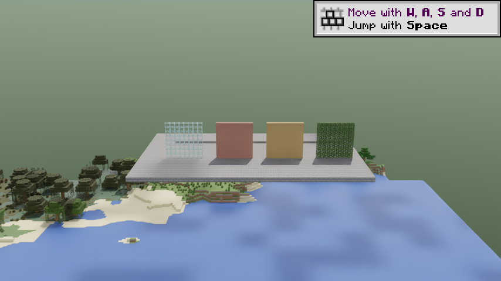

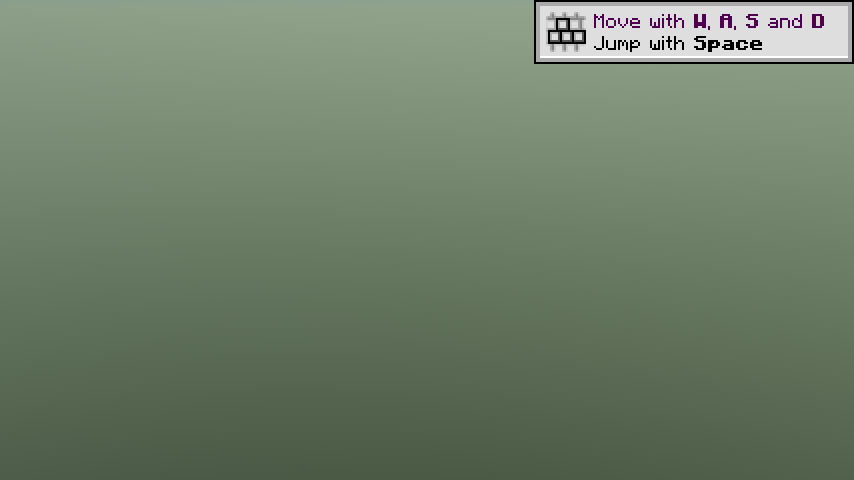

Raw logs and screenshots stay locally under ignored `artifacts/2026-10-15/`.

## Atomic 3D publication: gysf 0.2.1 and vooxxy Vulkan 5

The consumer previously bypassed DH's initial 2D coarse filter but still used
the 2D progressive eviction path. Ready geometry could therefore retire a
different vertical layer, and changed multi-batch sources could mix old and
new revisions. Voxy now stages complete overlapping 3D branches and switches
them atomically, retaining empty leaves as explicit replacements. DH's input
continues to use its own 2D policy. Hidden replacement resources remain owned
by the build session until publication or cancellation.

`check` passes 142 gysf tests plus 22 provider tests (164 total), with no
failures/errors. The ten new transition tests include 100 shuffled completion
orders that retain the full covered volume and never publish overlapping
branches. Multi-batch source updates, coarsening, negative coordinates,
vertical separation and empty replacement markers are covered. Shader/SPIR-V,
Minecraft ABI and production JAR checks also pass.

The extended joint command uses the usual 854x480, 1 spp, 2-bounce, 512-block
settings, DLSS-RR active and OMM disabled for the SDK issue above:

```powershell
$env:JAVA_TOOL_OPTIONS='-Dcaustica.rt.omm=false -Dgysf.smoke.textureFixture=true -Dgysf.smoke.visualControl=true -Dgysf.smoke.motion=true -Dgysf.voxy.validateCoverage=true'
$env:VK_KHRONOS_VALIDATION_VALIDATE_SYNC='true'
.\scripts\Build-26.3.ps1 -Joint -ValidateVulkan
```

This 2900-tick route reloads resources, visits the Nether and returns, traverses
both positive and negative X coordinates while changing height, forces an RT
LOD refresh during movement, teleports to another quadrant, returns to the
fixture, saves and exits. The harness verifies observed player coordinates,
replacement activity and published partition checks, in addition to textured
meshes, foliage coverage, atlas binding and compositor health.

Final paired run (`smoke-coverage-final.log`, provider `616215e3`):

| Measurement | Result |
| --- | ---: |
| RT frames | 5657 |
| Peak selected source meshes, including empty coverage | 890 |
| Peak resident RT BLAS sections | 671 |
| Packed textured batches | 2392 |
| Final atlas slot | 7 |
| Converted foliage cutout quads | 160584 |
| Completed atomic groups, including bootstrap/reuse | 2309 |
| Groups replacing existing source geometry | 886 |
| Validated published partitions | 176 |

Observed motion spans X=-383.5..464.5 and Y=80..192. The manual refresh is
recorded during that route. Resource reload and Nether/Overworld round trip
complete; the final refresh is still streaming when save/shutdown cancels its
unpublished work. There are zero Vulkan VUIDs, synchronization hazards, device
losses, coverage/revision assertion failures, provider failures or compositor
failures. Existing optional-DH class and Windows OSHI counter warnings remain.

Visual inspection shows the fixture after the motion/teleport return. The
same-camera control still removes the textured fixture and far terrain while
keeping the native near-terrain path enabled. This establishes the exercised
LOD path, publication invariants and lifecycle. It does not establish
crack-free geometric silhouettes, matched near/far water/PBR shading, temporal
performance or bounded long-travel VRAM. Those remain separate work.

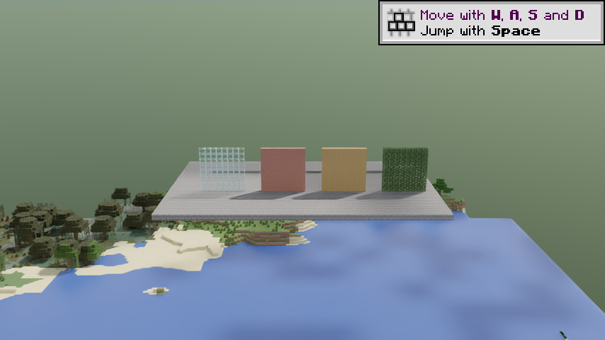

The first exploratory run also passes with 5635 frames, 698 replacement groups
and 1985 partition checks. Its per-source checkpoint cadence was reduced before
the final run: independent new sources and same-key updates use bounded/time
checkpoints; completed topology replacements can publish immediately. The two
runs encounter different cached terrain and are not a timing comparison.

The paired JARs, SHA-256 manifest, final screenshots and raw build/runtime logs
are retained locally in `artifacts/2026-10-15/coverage/`.

## Native LOD budget: gysf 0.3.0 and vooxxy Vulkan 6

`check` passes 155 gysf tests and 25 provider tests (180 total), with no failures
or errors. New tests cover concurrent reservations, VMA actual-size padding,
rollback/destruction accounting, cached process-headroom estimates, unavailable
driver estimates, reclaiming metadata, distance limits and recovery hysteresis.
Shader/SPIR-V, Minecraft ABI and production JAR checks pass. See
[GPU-MEMORY.md](GPU-MEMORY.md) for the accounting scope and primary references.

The first extended joint GPU run enables memory-budget pressure injection,
driver-budget assertions, 3D coverage validation, the material fixture and
motion route. It still uses 854x480, 1 spp, 2 bounces, a requested 512-block
LOD range and DLSS-RR with OMM disabled for the SDK checker issue.

At tick 400 the isolated process quota changes to 1 MiB. Five allocation
deferrals reduce the temporary provider distance to 256 then 128 blocks. The
existing published native working set decreases from about 148 MiB to 18 MiB
as out-of-window geometry retires; it is not forced below a newly lowered
1 MiB quota by dropping visible fallback geometry. There are 199 ticks with a
resident fallback during the injected pressure window. Restoring the original
quota at tick 600 recovers distance through 256, 384 and the requested 512
blocks before resource reload at tick 1000.

The driver extension is active and reports a 7131 MiB budget for the largest
device-local heap. The default native LOD quota is 1782 MiB. These are the
driver's current guidelines, not a physical-VRAM guarantee. The sampled process
usage includes Minecraft, provider resources, RT resources and vendor runtimes;
the provider-owned counter is about 612 MiB and is not added to driver usage.

| Injected-quota run | Result |
| --- | ---: |
| RT frames | 5596 |
| Peak selected source meshes | 932 |
| Peak RT BLAS sections | 618 |
| Converted textured batches | 2375 |
| Replacement groups / validated partitions | 475 / 166 |
| Allocation deferrals / distance reductions / recovery steps | 5 / 2 / 3 |
| Peak accounted native LOD allocation bytes | 202213936 |
| Native LOD allocation bytes at shutdown | 0 |

The run completes resource reload, Nether/Overworld round trip, variable-height
motion, teleport, manual RT refresh, save and shutdown. No Vulkan VUID,
synchronization hazard, device loss, coverage assertion, provider failure or
compositor failure is reported. The existing OSHI/optional-DH startup warnings
remain. The injection tests the consumer's quota path; it does not deliberately
exhaust the physical GPU or prove behavior under every driver-heap pressure
event. Extended travel, other GPUs and full-process allocation control remain
outside this acceptance.

The independent default-budget run uses the final provider `20c82bde` and
requires zero deferrals (`gysf.smoke.noMemoryDeferrals=true`). It completes the
same 2900-tick lifecycle/motion route with 5655 RT frames, peak 942 selected
source meshes, 955 resident RT BLAS sections, 2468 converted textured batches,
660 replacement groups and 262 validated partitions. The native LOD accounting
peak is 300358048 bytes (about 286.4 MiB), including transient and retiring
allocations. Deferrals, distance reductions and recovery steps are all zero;
the temporary limit remains cleared. Accounted native LOD allocation bytes are
zero at shutdown. Driver-budget and compositor assertions pass, with no Vulkan
VUID, synchronization hazard, device loss or provider failure.

Visual inspection of the default fixture shows per-face textures, cutout leaves,
glass and cached coastal terrain. The injected-quota view can still have an
unfinished horizon while the restored selection streams in; restoring a
distance limit does not mean all newly requested acceleration structures are
already built. This is not a geometric seam, temporal-image or performance
acceptance. The two runs visit/reuse different cached selections, so their
working-set peaks and frame counts are not a controlled performance comparison.

The final paired JARs, hashes, screenshots and raw records remain in ignored
`artifacts/2026-10-15/memory/`. The production JARs exclude the smoke mod. No PCL
mods, configuration or player saves are changed by these runs.

## Water tint and near-terrain ownership: 0.3.1

gysf 0.3.1 uses the paired provider `20c82bde` without a provider API change.
The near-ready probe now follows the represented voxel's inward face axis,
rather than the incoming ray direction. Voxy's sloped fluid normal remains a
shading normal; its packed face determines ownership. Hit positions and the
readiness mask share the terrain rebase.

Water tint is now normalized biome colour, matching the near fluid mesher's
optical input. Ordinary block albedo stays linear. The baked water sprite no
longer multiplies colour or masks water coverage, including shadow tint.
Outward LOD water crossings use the existing dielectric exit handler, while
entering crossings retain the glossy approximation and cannot push a new
absorbing medium from sparse LOD data. This is deliberately asymmetric.

All 157 gysf tests pass, including golden biome-colour packing values and the
separation of sloped fluid normals from packed voxel faces. Shader/SPIR-V,
Minecraft ABI and production JAR checks pass. The unchanged provider's 25 tests
were last checked in the preceding memory-budget validation; they are not a new
provider test run for this change.

The water fixture is a 32-block-wide quartz-bottomed pool across z=16..144.
Server-side checks verify water and floor along its entire centre line. At the
above-water camera, (64,110,32) is near-ready and (64,110,128) is not. The harness
also requires converted textured water, records a hidden-LOD control at the same
camera, and verifies that the later camera's eyes are underwater. Its temporary
forced chunks are removed before the dimension round trip.

An initial setup run failed because fill commands extended into unloaded
chunks; the underwater-camera assertion rejected that incomplete fixture. It
is retained locally as `smoke-incomplete-fixture.log`, not counted as a GPU
pass. Temporary test-world chunk loading and the complete-lane assertion fix
the fixture. No PCL world is involved.

The tint-only intermediate build completes 5981 RT frames, with native LOD
allocation peak 231086272 bytes and zero accounted bytes at shutdown. The final
exit-enabled build completes the same full 2900-tick route:

| Final water run | Result |
| --- | ---: |
| RT frames | 6939 |
| Peak selected source meshes / resident RT BLAS sections | 1036 / 725 |
| Converted textured batches | 2770 |
| Replacement groups / validated partitions | 1172 / 168 |
| Converted water quads, cumulative across rebuilds | 894512 |
| Peak accounted native LOD allocation bytes | 236665632 |
| Native LOD allocation bytes at shutdown | 0 |
| Memory deferrals / distance reductions | 0 / 0 |

The final run completes reload, Nether/Overworld return, variable-height travel,
teleport, manual RT refresh, save and shutdown. Real driver-budget reporting is
active. Neither complete run reports a Vulkan VUID, synchronization hazard,
device loss, provider/compositor failure or coverage assertion. OMM remains off
for the installed SDK checker issue. These frame and working-set counts are
activity evidence, not a controlled performance comparison.

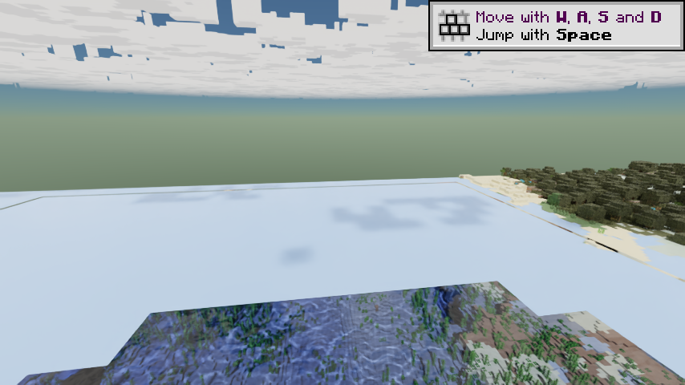
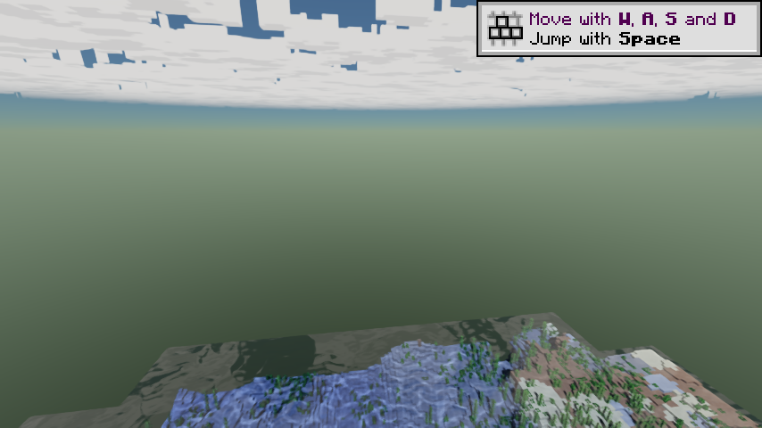
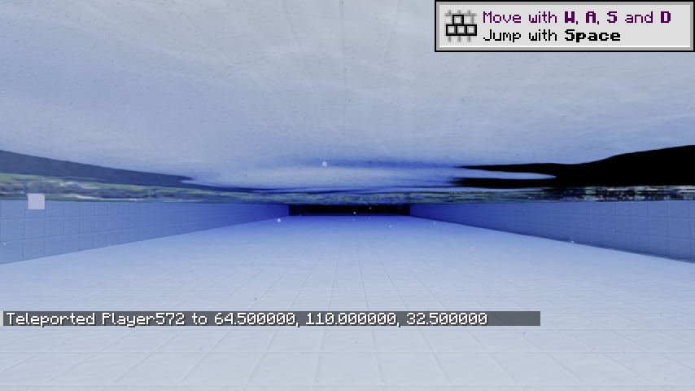

The hidden control confirms that the far pool and cached terrain are supplied
by textured LOD. The above-water view contains reflected sky and pool geometry;
the underwater view retains a dark band near the surface in this 2-bounce
setup. Its cause has not been isolated. These images do not establish a visual
improvement from the exit path or a complete near/far water match. Incoming
far-water transmission/absorption, waves, geometric quantization and the
remaining dark band still require separate visual controls. The ownership and
optical-input changes are narrower than seamless-water or performance acceptance.

Raw records, intermediate/final screenshots and paired JARs stay in ignored
`artifacts/2026-10-15/water/`. The production JAR excludes the smoke mod. PCL
mods, settings and player saves remain untouched.

## Underwater dark-band diagnosis

The isolated `gysf.smoke.waterMatrix=true` run freezes wave speed at zero and
records the same underwater camera with LOD hidden, waves off, 8 bounces, and
denoising off at 8 and 2 bounces. It reloads resources but deliberately skips
the dimension/motion route, finishing at tick 1720. No player instance is used.

Hiding LOD leaves the broad dark band. More bounces reduce it. Source inspection
finds that Pass A's unsplit TIR/pure-transmission branches use ordinary displaced
point offsets, while split branches and Pass B use `waterWaveContinueOrigin`.
An underwater crest can therefore restart its reflected ray above the original
BLAS plane and hit that plane again, spending path depth on a false interface.
Both unsplit branches now use the same wave-aware continuation origin.

`scripts/Test-WaterOrigins.ps1` compiles the production Slang water module to its
host backend, builds a small MSVC runner, and executes 2080 crest/trough,
top/bottom and outgoing-direction cases. It checks origins against both planes
and reproduces a positive-distance rest-plane self-hit for the old TIR offset,
with no positive hit for the corrected origin. All 2080 cases pass. The unused
host scene binding is opaque; no GPU scene traversal or Java math copy is used.
This optional probe requires Slang, CMake and MSVC and is excluded from the mod.

The original 157 Java tests, shader/SPIR-V, ABI and JAR checks also pass. Paired
before/after GPU matrices complete with no Vulkan VUID, synchronization hazard,
device loss or compositor/coverage failure; native LOD bytes return to zero.

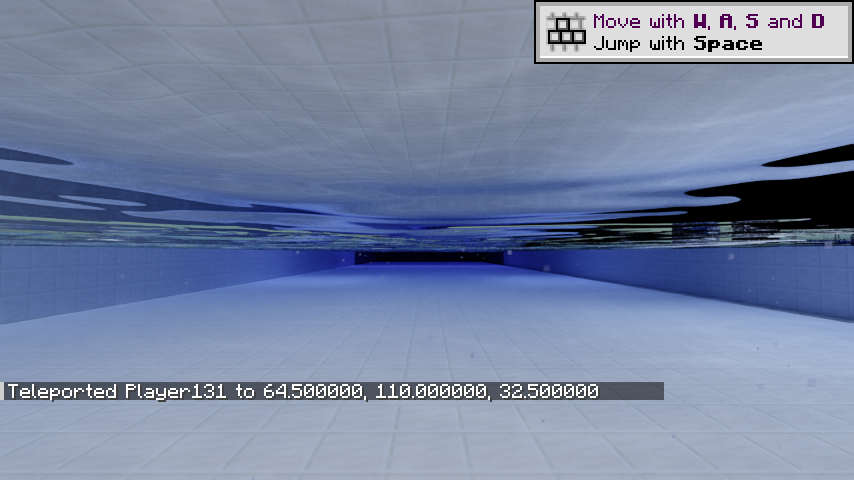
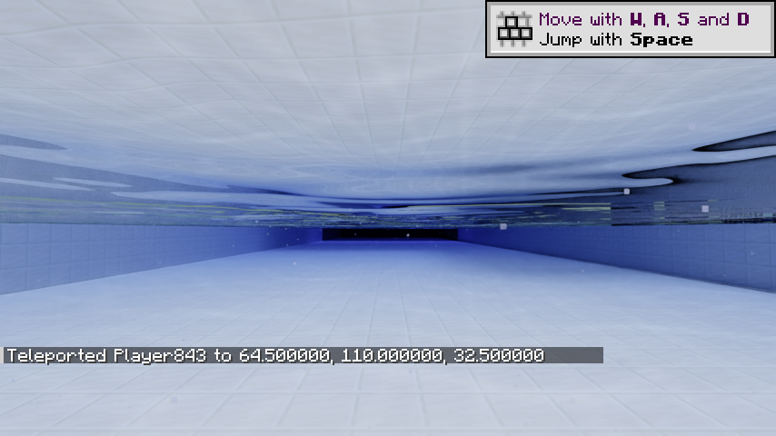

In the fixed 854x480 ROI x=520..853, y=120..244, pixels with every RGB channel
below 20 decrease from 9768 to 129 (98.7%). With LOD hidden the corresponding
counts are 9788 and 188. Raw 2-bounce counts decrease from 55 to 0. These are
narrow dark-band diagnostics, not a general image-quality score or benchmark.
Low path caps can still truncate legitimate multi-interface paths, and distant
water-volume attenuation remains visible. The origin fix addresses false
self-intersections without changing the bounce budget.

## Shared near/far water path: 0.4.0

API 5 water now selects `MATERIAL_WATER` for entering as well as exiting hits,
using the near fluid material's parameters and normalized biome tint. Its
Fresnel, refraction, volume absorption, geometric waves, caustics and guide
generation therefore follow the same shader path as near water. Legacy DH and
colour-proxy entry hits keep their separate glossy approximation. This changes
the typed consumer only; the paired provider remains `20c82bde`.

Reflected guide probes also keep the original BLAS plane in `SpecSurface` and
use the same wave-aware origin as the radiance continuations. Their returned
distance is reconstructed from that actual probe origin, not from the displaced
surface point. This fixes the remaining mismatch between reflected guide and
radiance origins without changing the payload or provider ABI.

The production 0.4.0 JAR passes all 157 Java tests, shader/SPIR-V, Minecraft ABI
and JAR checks. The production Slang origin probe passes all 2080 cases and its
TIR negative control. The JAR excludes both smoke and host-test code. The
unchanged provider is not rebuilt or retested for this consumer-only change.

The final 2900-tick joint run uses the product-default 4-bounce cap, 854x480,
1 spp, DLSS-RR, a requested 512-block LOD distance, coverage validation and real
driver-budget assertions. The water fixture's phase is held still for captures
and restored before travel. OMM remains disabled for the installed SDK checker.

| Final lifecycle/motion run | Result |
| --- | ---: |
| RT frames | 5448 |
| Peak selected source meshes / resident RT LOD BLAS sections | 1347 / 1052 |
| Converted textured batches / cumulative water quads | 2360 / 708345 |
| Replacement groups / validated partitions | 280 / 157 |
| Peak native LOD allocation bytes / shutdown bytes | 336431744 / 0 |
| Allocation deferrals / distance reductions | 0 / 0 |

It completes resource reload, Nether/Overworld return, variable-height travel,
teleport, manual RT refresh, save and shutdown with no Vulkan VUID,
synchronization hazard, device loss or compositor/coverage failure. The first
post-reload underwater screenshot is not used for far-water visual acceptance:
only 30 of 991 new LOD batches are ready near capture time, producing a missing
far wall while the new atlas/scene repopulates. A resource epoch reset cannot
keep drawing invalid old-atlas data; repopulation remains progressive.

Two separate `waterCompareOnly` runs remove reload, dimension changes and travel
from the comparison. Both use the same cameras, frozen wave phase, FOV and
4-bounce cap. Server checks verify the whole pool centre line. The mixed run
has 64/129 near-ready centre-line samples and requires the far sample to remain
LOD-owned; the 12-chunk reference requires all 129/129 samples to be near-ready.
Both underwater captures have 1037 resident LOD BLAS instances elsewhere in the
scene, so the comparison does not confuse a just-cleared LOD scene with water.

| Stable visual run | RT frames | Peak native LOD bytes | Shutdown bytes |
| --- | ---: | ---: | ---: |
| Mixed near + API 5 water | 3235 | 342157744 | 0 |
| Full-near pool reference | 3385 | 344005344 | 0 |

Both stable runs finish without Vulkan findings, coverage/compositor failure or
allocation deferrals. These counts describe completed work, not performance.

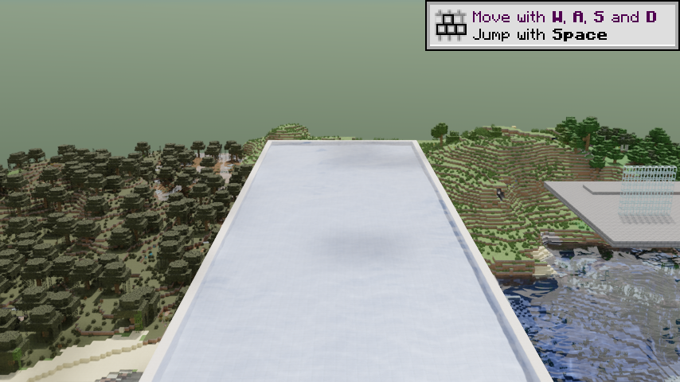
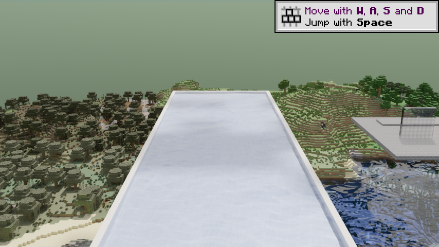
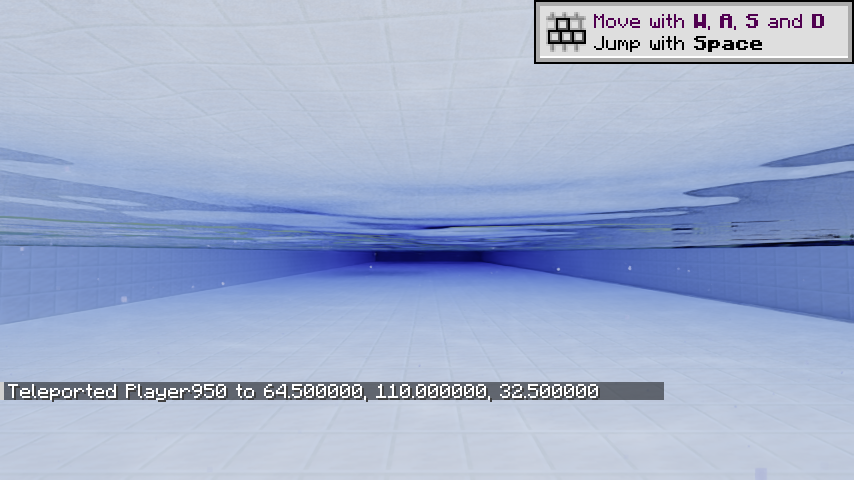
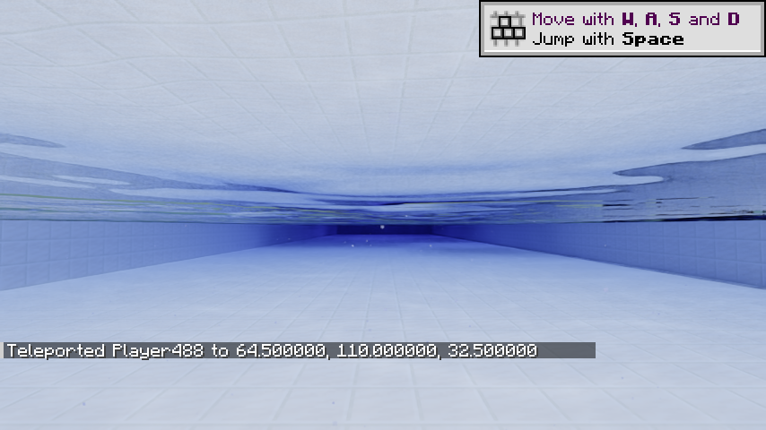

The pool surface, floor and reflections remain close across the two input
paths, without the broad black band or a missing far wall in these stable
captures. In the same dark-band ROI used above, the final 4-bounce mixed and
near-reference counts are 24 and 18 near-black pixels. These are not a causal
comparison with the earlier 2-bounce counts. Cloud phase, background coverage
and stochastic samples differ between processes; this is not pixel-equality,
temporal stability or universal seamless-water acceptance.

API 5 fluid heights still have three-bit 1/8-voxel precision, and distant cells
still simplify geometry. More precise flow/shoreline heights, refraction-aware
detail selection, different resource packs and longer travel remain separate
acceptance work. Source, screenshots, paired JARs and raw records are kept in
`artifacts/2026-10-15/underwater/`. No PCL files or player saves are changed.

## Fluid height continuity: 0.5.0 / provider Vulkan 7

The provider now exports optional API 6 UNORM16 corner heights before its legacy
three-bit raster quantization. gysf copies that sidecar with the immutable mesh
and uses it for RT top and side vertices. Both sides of the water handoff retain
the shared 0.4.0 optical path. The old packed quad layout and API 5 reader fallback
remain supported. Standalone raster generation does not allocate the sidecar.

All 161 gysf Java tests and 32 provider Java tests pass, together with shader,
SPIR-V, Minecraft ABI and JAR checks. New cases cover all four side/top edges,
multiple voxel scales, immutable ownership, bucket order and reuse, and 10,001
height inputs. UNORM16 error is bounded by about half of 1/65535 of a source
voxel before FP32 position rounding; this does not recover coarse world detail.

The isolated still-water cell at (64,111,64) is checked through actual provider
export, reflective consumer copying and production RT corner conversion. Its
expected world height is 111 + 8/9. Separate stable 4-bounce runs show:

| Geometry path | Measured world Y | Maximum error in blocks | RT frames | Native LOD peak / shutdown bytes |
| --- | ---: | ---: | ---: | ---: |
| API 6 precise heights | 111.888885 | 0.0 | 2856 | 263355488 / 0 |
| API 6 with legacy-height control | 111.875 | 0.013885498 | 2116 | 214325008 / 0 |

Zero here means equal FP32 world coordinates for this fixture, not exact real
arithmetic for every possible height. The old error is about 1.39 cm at block
scale. Different cache/bootstrap progress makes these frame and allocation
counts unsuitable as a performance comparison. Both runs finish with clean
Vulkan/synchronization validation, no compositor/coverage failure and no
allocation deferrals. Their first probe revision packed one synthetic quad;
the probe now calls the same production corner converter without incrementing
render counters. The initial provider JAR carried the pre-commit `20c82bd`
suffix; its feature source was subsequently committed as `45b4a50b` and rebuilt
as `voxy-vulkan-0.2.20-26.3-vulkan.7-dev-45b4a50.jar` for final verification.

A separate compatibility run loads the real API 5 provider Vulkan 6 JAR, rather
than just hiding API 6 data with a flag. gysf 0.5.0 discovers the missing optional
method and keeps the old height path: 3084 RT frames, 998 peak resident RT LOD
sections, zero precise-height quads, the expected 0.013885498-block legacy error,
and 325652832 peak / zero shutdown native LOD bytes. It completes without Vulkan,
synchronization, compositor or coverage failures.

The pinned provider also passes its standalone Sodium Vulkan lifecycle run:
38,303 block-state round trips, live edits, disabled-renderer control/rebuild,
window/FOV/distance changes, resource reload, dimension return and save/shutdown.
All Voxy GPU wrappers are released, with no Vulkan validation findings. An
earlier attempt exposed a smoke-harness race: terrain invalidation could rebuild
the renderer while the visual control had shut it down but left its desired
state enabled. The harness now disables that state during the control and
asserts it stays disabled; production renderer guards are unchanged.

The final pinned API 6 pair completes the full 2900-tick route at 4 bounces,
854x480, 1 spp and DLSS-RR, with Vulkan synchronization/coverage validation and
real driver-budget assertions. OMM remains off for the installed SDK checker.
A temporary 1 MiB LOD budget at ticks 400..600 deliberately denies allocations;
the test requires published fallback to remain visible and provider selection
to reduce, then recover fully before the resource reload at tick 1000.

| Final lifecycle/motion/pressure run | Result |
| --- | ---: |
| RT frames | 5469 |
| Peak selected sources / resident RT LOD sections | 1347 / 675 |
| Textured batches / cumulative water quads | 2323 / 784482 |
| Cumulative quads using precise fluid heights | 887502 |
| Replacement groups / validated partitions | 286 / 140 |
| Native LOD peak / shutdown bytes | 272630240 / 0 |
| Deliberate allocation deferrals / distance reductions / recoveries | 5 / 2 / 3 |
| Ticks retaining published fallback during pressure | 199 |

The known fluid cell retains the expected precise height in this run too.
The observed motion spans X=-383.5..464.5 and Y=80..192. Resource reload,
Nether/Overworld return, explicit RT refresh, teleport, save and exit all finish
without Vulkan VUIDs, synchronization hazards, device loss or compositor/coverage
failure. Quads and swaps are cumulative work counters, not current residency
or a benchmark. Post-reload captures still show progressive scene repopulation
and are not used as stable water-image acceptance.

This milestone removes a measured height discontinuity. Coarse voxel shape,
fluid/ceiling occlusion parity, flowing shoreline fixtures, resource-pack
variants and temporal transition acceptance remain separate work. Raw records
and paired artifacts are kept in `artifacts/2026-10-15/fluid-api6/`. PCL mods,
configuration and player saves remain untouched.

## Real-shape fluid interfaces: provider Vulkan 8

The isolated `gysf.smoke.fluidTopology=true` fixture freezes the integrated
server while placing known fluid levels, open/solid shores, stone/glass/slab
ceilings, two glass-wall orientations, a fluid column, a waterlogged slab and a
flow surface across 32-voxel section boundaries. All sample water cells are at
Y=127, so the ceiling reads also cross a provider section boundary. It verifies
the client received every placed state, then invokes the actual near
`RtFluidMesher` with immutable snapshots and captures its emitted vertices.
The far side comes from real provider export, consumer reflection and production
RT corner conversion. Face presence and vertex sets are compared with a
0.00002-block tolerance; missing level-zero source sections are failures.

The Vulkan 7 diagnostic finds 10 mismatches in 18 comparisons: six extra water
interfaces and four covered-rim top surfaces with up to 0.1111145-block height
error. It deliberately allows mismatches to record them; its general runtime
PASS is not topology acceptance. Ordinary flow, an open shore, a solid shore
and the cross-section flow sample already agree within UNORM16/FP32 precision.

Vulkan 8's external generator now follows the near RT path's real neighbor-shape
and self-face rules. Covered fluid cells report full height, including under a
bottom slab, so adjacent corner averaging rises to the correct ceiling edge.
Glass and solid shapes suppress the corresponding false interfaces. The shape
context reads retained Voxy grid data and captured dimension height bounds;
workers never read a live client world. The standalone raster generator keeps
its prior policy. This is an API 6 provider change; gysf's production 0.5.0 code
and the packed quad ABI are unchanged.

All 36 provider Java tests pass, including full/empty shapes on every face,
top/bottom slab direction, partial-height side occlusion and corner ownership.
The pinned `bfe86787` provider completes a strict static topology run with all
18 comparisons matching, no extra faces, and maximum vertex error
0.0000076293945 blocks. It renders 18 matched faces where the Vulkan 7 control
had 24. Vulkan/synchronization validation is clean and native LOD allocation
returns to zero at exit. Raw records are under
`artifacts/2026-10-15/fluid-topology/`; no PCL files or player saves are used.

A second diagnostic first passes the same 18 static samples, then places a
glass ceiling at (63,128,63). With the original six-face invalidation policy,
three water cells across mixed X/Y/Z section boundaries retain old exported
vertices despite correct client states: (64,127,63), (63,127,64), (64,127,64).
Their maximum error reaches 0.6111069 blocks in this artificial flow fixture.
The runtime completes cleanly, but its allowed three geometry mismatches are
evidence of a stale dependency bug, not acceptance.

The external session now coalesces changed source keys on its selection worker
and invalidates the complete 3x3x3 section neighborhood at that same LOD. Two
additional tests cover the observed corner dependency and negative coordinates
at every supported level, bringing the provider suite to 38 passing tests.

The final `0e4365e1` provider passes the extended 1550-tick strict run. Its three
phases compare 18 initial samples, 21 after adding the diagonal ceiling, and 21
after restoring air. All 60 sample comparisons and 67 face comparisons match,
with maximum vertex error 0.0000076293945 blocks. The client verifies all placed
states in every phase. No allowed-mismatch flag is set. The run completes 3495
RT frames, 482 replacement swaps and 138 validated partitions; native LOD memory
peaks at 328362432 bytes and returns to zero. There are no Vulkan findings,
compositor/coverage failures or allocation deferrals. These are controlled
level-zero geometry results, not coarse-LOD, physics, resource-pack or temporal
image-quality acceptance.

The final 2900-tick joint run also enables the static topology fixture and the
existing lifecycle/motion/driver-budget/pressure assertions. It uses the same
4-bounce, 854x480, 1 spp, DLSS-RR setup with OMM disabled for the SDK checker.

| Final Vulkan 8 joint run | Result |
| --- | ---: |
| RT frames | 7211 |
| Peak selected sources / resident RT LOD sections | 1351 / 922 |
| Textured batches / cumulative water / precise-fluid quads | 3154 / 725606 / 823610 |
| Replacement groups / validated partitions | 886 / 171 |
| Native LOD peak / shutdown bytes | 301126464 / 0 |
| Deliberate allocation deferrals / reductions / recoveries | 5 / 2 / 3 |
| Client ticks retaining fallback during forced pressure | 199 |

The 18-sample geometry probe still matches before reload. The temporary provider
limit recovers fully before reload, and resource reload, Nether/Overworld,
manual refresh, motion X=-383.5..464.5 / Y=80..192, save and shutdown complete
without Vulkan findings or compositor/coverage failures. These counts describe
completed work, not a performance comparison with earlier processes.

The topology fixture deliberately adds suspended quartz, slab and glass shapes
above the pool. Its screenshots include those structures, their shadows and
reflections; they cannot be compared to the earlier clean-pool dark-band ROI or
used as universal seamless-water image acceptance. Different coarse geometry,
resource packs, normal fluid simulation and longer temporal routes remain open.

The same final provider source passes its standalone Sodium 0.9.3-alpha.1
Vulkan lifecycle/synchronization run: 38,303 block-state round trips, live edits,
renderer disable/control/rebuild, window/FOV/distance changes, resource reload,
Nether return, save and shutdown. All Voxy GPU wrappers are released with no
Vulkan findings. The paired development package keeps the unchanged gysf 0.5.0
JAR and `voxy-vulkan-0.2.20-26.3-vulkan.8-dev-0e4365e.jar`, with source pins,
hashes, Java-suite summary and both diagnostic and strict raw logs. No smoke
classes are shipped in either mod JAR.

## Flow triangle normals and displaced-water slope: gysf 0.6.0

Two new Java controls exercise the actual private `FluidCapture` and section
packer through test-only reflection. They reproduce a geometric-normal bug:
both triangles of a non-planar fluid quad receive the first triangle's normal.
One normal therefore is not perpendicular to its triangle, and differs from the
Voxy packer's per-triangle records. The planar face/tint control passes. The
near capture now computes each triangle's own normal; water and lava material
IDs, emission, tint, buckets and vertex/index layout are preserved. All three
new controls and the previous 161 tests pass (164 total).

`Test-WaterSurfaces.ps1` compiles the production Slang water module to its host
backend and runs 6338 cases. It sets the actual pushed water parameters, checks
the zero-height identity on sloped top/bottom faces, differentiates the complete
height field numerically, checks surface-height residuals for vertical/oblique
rays at four footprints, and compares equivalent rebased world coordinates.
The strengths are 0, 0.25, 1 and 4; the dynamic grid uses 8 phases and 16 positions.
Vertical height tolerance is 0.00003 blocks, oblique residual tolerance is
0.001 blocks, and finite-difference normal tolerance is 0.003 in vector length.

The old shader discards the rest-plane slope when forming the animated normal,
even at zero amplitude. Its fixed 0.55-block search range also clips high slider
values and does not account for a sloped rest plane's ray rate. The new shader
adds the analytic wave gradient to the actual plane slope and scales the search
envelope with the height multiplier and plane-relative ray rate. The iteration
count and side-face fallback stay unchanged.

| Production Slang diagnostic | Before | After |
| --- | ---: | ---: |
| Zero-amplitude identity failures / 162 | 160 | 0 |
| Finite-difference normal failures / 6144 | 6144 | 0 |
| Height-residual failures / 6144 | 1272 | 0 |
| Rebase failures / 32 | 0 | 0 |
| Maximum normal vector error | 0.821868 | 0.000668468 |
| Maximum height residual, blocks | 1.05543 | 0.0000152588 |

More than one assertion can fail in a case. The normal residual includes finite-
difference approximation and FP32 error; it is not a measured image-quality
score. The production origin probe still passes all 2080 cases and its old-TIR
self-hit negative control. Shader/SPIR-V, Minecraft ABI and JAR checks pass.
These changes affect gysf only; provider Vulkan 8 remains the pinned
`0e4365e1` artifact. Raw controls are in `artifacts/2026-10-15/water-normals/`.

The in-game geometry probe now reads actual near-fluid primitive normal records
through smoke-only reflection and compares them with the exported RT geometry.
An initial harness run rejects ten side triangles because near and Voxy use
different diagonals on the same vertical plane. The verifier now accepts an
alternative diagonal only when all four corners are coplanar within the existing
position tolerance; non-planar tops still require matching triangle vertices.
This corrects the verifier without removing the normal comparison or changing
the production fix. The failed harness log is retained separately.

The strict rerun has no allowed-mismatch flag. Across initial/add/restore phases
it passes 60 sample, 67 face and 134 triangle-normal comparisons. Maximum vertex
error is 0.0000076293945 blocks; maximum matched normal-component error is
0.000013224781, below the 0.0001 normal tolerance. These are CPU primitive records
from the real in-game production capture, not GPU buffer readback or an image
metric. The run also completes 1550 ticks with clean Vulkan validation and zero
native LOD bytes at shutdown.

The full 2900-tick run explicitly sets and retains wave strength 4 with speed 1,
keeps animation active, and combines the real normal/topology probe with the
existing reload, dimension, motion, coverage and driver-budget pressure checks.
It uses 854x480, 1 spp, 4 bounces and DLSS-RR, with OMM off for the SDK checker.

| Final maximum-height run | Result |
| --- | ---: |
| RT frames | 6197 |
| Peak selected sources / resident RT LOD sections | 1350 / 922 |
| Textured batches / cumulative water / precise-fluid quads | 2624 / 554308 / 661223 |
| Replacement groups / validated partitions | 368 / 143 |
| Native LOD peak / shutdown bytes | 291400464 / 0 |
| Deliberate deferrals / distance reductions / recoveries | 5 / 2 / 3 |
| Client ticks retaining fallback during pressure | 198 |

The probe still matches all initial sample normals and vertices at maximum wave
strength. Resource reload, Nether/Overworld return, manual RT refresh, movement
X=-383.5..464.5 / Y=80..192, save and shutdown finish without Vulkan findings or
compositor/coverage failures. The provider distance fully recovers before
reload. These are completed-work counters, not a performance comparison.

The host probe additionally checks an analytic upper envelope of all authored
wave components against the reference search bound. It uses the fact that the
crest exponential and each LOD weight are at most one; slider strength scales
the field and envelope equally. The 6338 sampled cases still pass, with the
same reported maxima. This numerical evidence does not establish exact shoreline
clipping, arbitrary grazing intersections or temporal image fidelity for the
raygen displacement proxy. The shaderTest/smoke classes are excluded from the
production JAR. PCL files and player saves remain untouched.

## Previous-frame wave field: gysf 0.6.1

Production source `6131ea0e` replaces the first-order temporal rewind used by
primary-water reflection normals and vertical motion with evaluation at the
actual previous phase. The current field is unchanged. Frozen, zero-height or
same-phase water reuses that result; secondary water and guide-chain hits
already pass equal times and do not need another spectrum walk. This requires
no provider or push-data ABI change. Vulkan 8 stays pinned to `0e4365e1`.

`scripts/Test-WaterTemporal.ps1` runs the production Slang temporal function via
the host backend and compares its previous height/normal with direct evaluation
at the previous phase. Its 12960 cases cover heights 0/1/4, speeds 0/1/4, five
clock phases through 3599.5 s, 16 positions, three footprints (0/2/16 blocks) and
six frame intervals through the CPU history window's 0.25 s limit. Acceptance
is 0.0001 blocks for height and 0.001 in normal vector length. Current-field
identity is checked separately at 0.000001. These thresholds were fixed before
the production fix. The old algorithm fails 2514 cases; the fixed algorithm
fails zero, including current-field identity.

| Interval, seconds | Old failing cases | Old maximum height error, blocks | Old maximum normal vector error |
| --- | ---: | ---: | ---: |
| 0 | 0 | 0 | 0 |
| 1/240 | 181 | 0.000947356 | 0.00183275 |
| 1/60 | 459 | 0.0147618 | 0.0235977 |
| 1/30 | 596 | 0.0547931 | 0.0938774 |
| 0.1 | 638 | 0.439502 | 0.545067 |
| 0.25 | 640 | 2.59633 | 1.09462 |

All reported maxima span the complete height/speed/phase/position/footprint grid;
they are not default-slider-only results. With the fix, previous-field error
is zero in this direct same-backend comparison. This verifies the temporal
math, not DLSS-RR image fidelity, independent physical accuracy or GPU cost.
Animated primary water needs an additional derivative-free spectrum evaluation;
frozen/secondary paths reuse the current result. No frame-time speedup is claimed.

The existing 6338 surface cases and 2080 continuation-origin cases still pass,
including the old-TIR negative control. Surface maxima remain 0.000668468 in
normal length and 0.0000152588 blocks in height residual. All 164 Java tests,
shader/SPIR-V compilation, Minecraft ABI, smoke-source compilation and production
JAR checks pass. Test classes are not included in the mod. Raw records are in
`artifacts/2026-10-15/water-temporal/`.

The isolated joint run explicitly sets and retains both wave strength and
speed at 4, with the pinned provider JAR. It completes 2900 ticks at 854x480,
1 spp, four bounces, DLSS-RR and requested 512-block provider distance. OMM is
off for the installed SDK checker defect; Vulkan synchronization validation is
enabled. Initial fluid geometry and 36 real primitive triangle normals match,
with the same vertex/normal maxima as the previous milestone.

| Maximum-height / maximum-speed run | Result |
| --- | ---: |
| RT frames | 5223 |
| Peak selected sources / resident RT LOD sections | 1353 / 752 |
| Textured batches / cumulative water / precise-fluid quads | 2213 / 500795 / 582659 |
| Replacement groups / validated partitions | 323 / 139 |
| Native LOD peak / shutdown bytes | 234154160 / 0 |
| Deliberate deferrals / distance reductions / recoveries | 5 / 2 / 3 |
| Client ticks retaining fallback during pressure | 199 |

Resource reload, Nether/Overworld return, manual RT refresh, movement
X=-383.5..464.5 / Y=80..192, save and shutdown pass without Vulkan findings or
compositor/coverage failures. Full distance recovers before reload. These work
counters vary with streaming and are not a frame-time comparison. The topology
fixtures add suspended shapes and their underwater image is not a clean-pool
dark-band comparison. A still image cannot establish temporal stability.
Displacement-proxy shoreline clipping, long-distance anchor continuity and
continuous-frame visual acceptance remain open. PCL mods/configs/player saves
were not changed.

## Full-origin and clock phase transport: gysf 0.6.2

Production source `99b00b24` fixes two discontinuities in the water field.
Reducing the terrain origin modulo 4096 is not a symmetry of the incommensurate
wave spectrum, so a rebase across that boundary changes water at a fixed world
point. Resetting wave time modulo one hour likewise changes the phase. Keeping
large float times also loses enough precision to spoil otherwise-correct
spatial transport.

An initial production-Slang diagnostic compares 7776 pairs of representations
of the same world point at four short phases. The old 4096 policy fails 3072
pairs, with maximum height difference 1.21171 blocks and gradient difference
0.518091. A spatial-only transport fixes that grid but fails 344 / 11664 pairs
after adding clock phases 1023.875 and 3599.5 seconds. Its maxima are
0.00207889 blocks / 0.00126016 gradient vector length. The intermediate JAR,
build and GPU log are retained in `water-domain/space-only/` with a NOT-ACCEPTED
label. Its successful runtime is not acceptance of the failed expanded grid.

The final transport uses the exact FP32 spatial coefficients and dispersion
frequency on both CPU and shader sides. CPU double arithmetic combines each
wave's full integer terrain origin and an eight-second time base, then reduces
the resulting phases modulo two pi. GPU evaluation uses local hit coordinates
and the small time relative to that base. The previous frame uses the same base,
so its time can be negative just after a base change. First frames, pauses over
0.25 s, time rewinds and output-history resets use neutral motion history.
The physical field continues across the one-hour wall-clock wrap; the wrapped
portal/glint clock remains separate.

Seven reflected 32-byte domains add 224 bytes to the per-frame world data.
They contain main/meander spatial coefficients, reduced phase offsets and the
shared frequency. The cache rebuilds only when terrain origin, time base or
speed changes. Java serialization and the shader struct are generated/reflected
together. The provider API and Vulkan 8 artifact remain unchanged. This is not
a measured GPU performance improvement. Changing the speed slider still has
the pre-existing once-per-change phase warp described by its tooltip.

`Test-WaterDomain.ps1` compiles the actual Java transport/clock classes to make
fixtures, then feeds their coefficients and phases to production Slang via its
host backend. The final 15552 pairs cover nine signed origins through
approximately +/-30 million blocks, four positions, heights/speeds 0/1/4,
footprints 0/2/16, and eight timestamps (0, 0.37, 8, 1023.875, 3599.5, 3600,
86400 and 604800.125 seconds). One pair mode changes origin by (+512,-1024);
the other changes the time-base representation by eight seconds while holding
the physical point/time fixed. Both current and previous fields are compared.
Height tolerance remains 0.0001 blocks and gradient tolerance 0.001. Coefficients
and frequency are also compared with the authored Slang basis at 0.000002.

| Final paired field diagnostic | Transport | Legacy mask/wrap control |
| --- | ---: | ---: |
| Pairs | 15552 | 15552 |
| Failing pairs | 0 | 3936 |
| Maximum height difference, blocks | 0.000023365 | 1.49498 |
| Maximum gradient vector difference | 0.000059317 | 0.560481 |
| Maximum authored-basis difference | 0 | 0 |

The legacy clock control compares the continuous unwrapped phase reference
against the old hourly-wrapped phase at the same physical timestamp; it is not
two recorded game frames. The final numbers describe a Windows Slang C++ host
backend, not numerical GPU readback. Three clock unit tests independently check
adjacent history across zero/eight-second/hour/day/week boundaries, the exact
history limit, pause/rewind/reset and sub-frame precision after a week. All 167
Java tests pass, along with shader/SPIR-V, Minecraft ABI and JAR checks. The
existing 12960 previous-field, 6338 surface and 2080 origin cases still pass.
The surface finite-difference maximum is 0.00070478 in normal vector length;
maximum height residual remains 0.0000152588 blocks. Source reassociation and
transport leave these within their original tolerances.

The final 2900-tick isolated joint run keeps wave height/speed at 4, 854x480,
1 spp, four bounces and DLSS-RR, with Vulkan synchronization validation and
the pinned provider JAR. OMM is off for the SDK checker defect. The motion
route now crosses both signed 4096-block regions. It asserts actual near-terrain
origins below -3800 and above 3800 in addition to observed player coordinates.

| Final space/time transport run | Result |
| --- | ---: |
| RT frames | 5200 |
| Peak provider meshes / resident RT LOD sections | 1353 / 541 |
| Textured batches / cumulative water / precise-fluid quads | 2202 / 533961 / 607916 |
| Replacement groups / validated partitions | 250 / 143 |
| Native LOD peak / shutdown bytes | 170730816 / 0 |
| Deliberate deferrals / distance reductions / recoveries | 5 / 2 / 3 |
| Client ticks retaining fallback during pressure | 199 |
| Observed player X / terrain origin X | -4351.5..4416.5 / -4352..4288 |

Near/far fluid positions, face presence and 36 actual primitive normals still
match at the initial fixture. Resource reload, Nether/Overworld return, manual
RT refresh, motion, full provider-distance recovery before reload, save and
shutdown pass without Vulkan findings or compositor/coverage failures. These
are completed-work counters and lifecycle checks, not frame-time measurements.
The GPU route does not visit the world border or run for a week; those cases
belong to the host probe. Suspended topology fixtures affect these still images,
which are not a clean-pool dark-band or continuous-frame temporal comparison.
Exact shoreline clipping, arbitrary grazing proxy intersections and full visual/
performance qualification remain open. PCL files and player saves are untouched.
