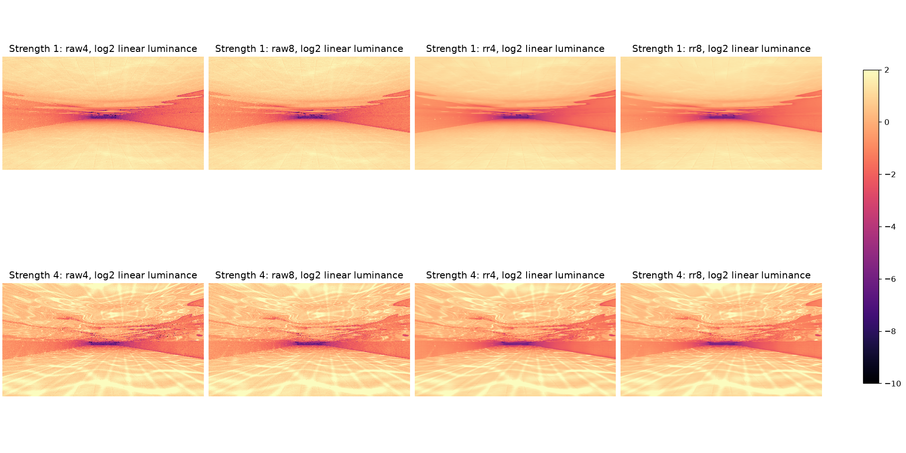

# Controlled underwater radiance audit

The clean finite-water pool no longer reproduces the historical broad black TIR band under the
controls below. This is a bounded flat-pool result, not acceptance of every natural shoreline, moving
water or the player's world. No image-quality change or frame-rate gain is claimed from this audit.

## What actually ran

The isolated development client fixes the eye at `(64.5,111.62,32.5)`, yaw 0, pitch -2 and FOV 70.
Wave speed and camera jitter are zero, clouds are off, exposure is manual EV 0, OMM is off, and scene
publication/field residency must settle before capture. Strength 1 and 4 each have four controls:

- 32-spp unfiltered radiance with four and eight path bounces.
- 1-spp DLSS RR with four and eight bounces, native AA quality 5.

All trace and output images are 427x240, including live RR. The test waits at least 64 rendered frames
per phase; 32 spp is applied only to the raw reference's recorded frame. Scene loading and readback
retirement use 1 spp. The actual GPU WorldPush verifies spp, bounce cap, shader feature flags, camera,
medium, projection, jitter, wave parameters and unchanged field history. The same water material and
interface positions/pixel rays must remain visible across controls.

`gysf.rt.captureResolvedGuides=true` extends the opt-in guide capture with the exact same frame's HDR
image after reconstruction/fallback upscale, before exposure and tonemapping. The metadata reports
the actual filter (`none`, `dlss-rr`, `nrd` or `svgf`) and whether RR produced the frame. Each resolved
image has an explicit extent and format. The existing bounded pixel budget, exact graphics-use wait,
mapped invalidation, restored image layouts and shutdown ownership also cover this extra buffer.

For raw controls all other filters/upscalers are explicitly disabled. The reader requires elementwise
equality between the decoded raw and resolved RGB values, so an accidentally enabled post filter cannot be
silently accepted as a raw reference. These 32-spp/eight-bounce samples remain finite and stochastic;
they are not unbiased ground truth or a per-pixel causal estimate across independently seeded frames.

## Evidence and limits

Local evidence is under `artifacts/2026-10-16/water-optics/`:

- `matrix.log` was aborted before an accepted capture: sustained 32-spp warmup starved scene
  publication. It does not qualify shutdown/resource lifetime or normal gameplay performance.
- `one-frame.log` completed all captures, but its optical references are rejected. Disabling
  `Composite.DENOISER` does not disable the independent SVGF setting. Raw/resolved values differed,
  and the reader correctly rejected them. Both the data and rejection marker are retained.
- `controlled.log` explicitly disables SVGF/NRD/other upscalers and passes all eight captures with
  real native-resolution RR, synchronized NGX clears, and strict Vulkan/synchronization acceptance.
  The raw controls have identical pre/post RGB values. Guide, field and native LOD live-byte counters
  all return to zero at shutdown. These counters exclude retained allocator pools and total VRAM.
- `controlled-analysis/results.json`, `profiles.csv` and `luminance.png` contain the raw HDR analysis.

The primary water-interface mask contains 53,215 pixels in each control. Approximate TIR masks use the
captured unit normal, ray and water IOR 1.333: 53,215 pixels at strength 1 and 52,821 at strength 4.
Only 32/99 of these water pixels are LOD-owned at strength 1/4: this close-to-surface, wide-FOV camera
primarily checks the common underwater optical path. It must be combined with the separate mixed/near
guide comparison, whose underwater interior includes 451/537 compared LOD pixels, rather than used as
a replacement for far-water coverage.
The table reports the entire water mask, with linear luminance `0.2126 R + 0.7152 G + 0.0722 B`.

| Strength | Control | Raw mean | Resolved mean | Resolved pixels below .001 | Resolved pixels below .00001 |
| --- | --- | ---: | ---: | ---: | ---: |
| 1 | 32 spp, four bounces | 1.59920 | 1.59920 | 7 | 1 |
| 1 | 32 spp, eight bounces | 1.68331 | 1.68331 | 2 | 1 |
| 1 | RR, four bounces | 1.60223 | 1.58223 | 0 | 0 |
| 1 | RR, eight bounces | 1.68181 | 1.65908 | 0 | 0 |
| 4 | 32 spp, four bounces | 1.54389 | 1.54389 | 18 | 15 |
| 4 | 32 spp, eight bounces | 1.60553 | 1.60553 | 2 | 0 |
| 4 | RR, four bounces | 1.54078 | 1.51404 | 0 | 0 |
| 4 | RR, eight bounces | 1.60775 | 1.57058 | 0 | 0 |

There are no RR-output pixels below .00001 where the corresponding 32-spp reference is above .01,
for either bounce cap/strength. The gross black-region gate requires this and fewer than 1% nearly
black pixels in the eight-bounce raw reference. Passing it only excludes that gross regression in
this fixture; it does not prove exact reconstruction, absence of blur, unbiased transport or full
scene visual acceptance. Independent seeds and different samples preclude interpreting every
four/eight-bounce pixel difference causally. The modest aggregate brightness increase with more
bounces is compatible with legitimate multi-interface path truncation; it does not justify removing
physical water attenuation or globally brightening the image.



The run also passes the 207 Java tests, shader/ABI/JAR checks and 14 log-checker fixtures. It is not
a performance benchmark: resolutions, spp and bounce caps deliberately differ from normal gameplay,
and capture/readback overhead is present. The next work is matched frame-time/DLSS measurement and
natural/coarse shore topology, with the fixed-camera GPU guide comparison retained as a regression.
The PCL instance, its mod pair and player saves were not changed.

## Repeat

After setting Java 25, Vulkan SDK and the staged DLSS SDK as in the guide-capture document, with no
other Minecraft process running:

```powershell
.\scripts\Test-WaterGuides.ps1 -Optics -OutputDir artifacts/my-fresh-water-optics
```

The optional optical matrix is separate from the four-phase mixed/near geometry comparison. Default
invocation still runs that comparison. Existing evidence directories are rejected. The reader is
also independently callable with `Analyze-WaterOptics.py CAPTURE_ROOT --output ANALYSIS_ROOT`.
